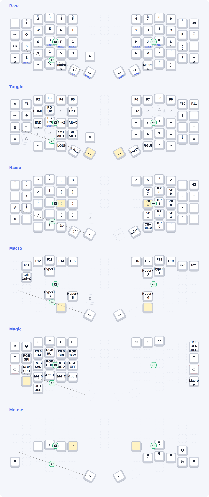

# ZMK Sofle with Dongle

ZMK firmware configuration for a split **Sofle** keyboard (Eyelash Sofle) that connects through a **nice!nano v2 dongle** with an OLED display. The keymap mirrors a MoErgo Go60 and can be regenerated from a Go60 firmware file with a script in this repo.



<sub>Auto-generated by the *Draw Keymap* GitHub Action. [Dark version](keymap-drawer/eyelash_sofle-dark.png) · [SVG](keymap-drawer/eyelash_sofle.svg)</sub>

## Layers

| # | Layer | How to reach it |
|---|-------|-----------------|
| 0 | Base | default |
| 1 | Toggles (navigation and function keys) | hold Space |
| 2 | Raise (symbols and numpad) | hold `F` or `J` |
| 3 | Macros (app shortcuts) | tap or hold the Macros key (sticky layer) |
| 4 | Magic (Bluetooth, RGB, bootloader, media) | hold `Z` |
| 5 | Mouse (cursor, scroll, buttons) | hold `G` or `H` |

Home-row mods, combos (Enter, Option+Backspace) and an encoder for volume are defined in [`config/eyelash_sofle.keymap`](config/eyelash_sofle.keymap).

## Repository layout

| Path | Purpose |
|------|---------|
| `config/eyelash_sofle.keymap` | Keymap (layers, combos, macros, behaviors) |
| `config/eyelash_sofle.conf` | Firmware options (RGB, debounce, display, mouse) |
| `config/eyelash_sofle.json` | Physical layout used to draw the keymap |
| `config/west.yml` | ZMK and module dependencies |
| `boards/shields/eyelash_sofle/` | Shield definition (dongle, left and right halves) |
| `build.yaml` | Firmware targets built by GitHub Actions |
| `scripts/uf2_to_zmk.py` | Convert a Go60 `.uf2` into this keymap |
| `scripts/render_keymap.py` | Render the keymap images locally |
| `keymap_drawer.config.yaml` | Theme and legend settings for the keymap image |

## Building and flashing

Push to GitHub. The **Build ZMK firmware** action builds everything listed in `build.yaml`. Download the `firmware` artifact from the latest green run and unzip it.

### Which file goes on which board

The keyboard has three nice!nano v2 boards: the dongle (receiver with the screen), the left half and the right half.

| Board | File |
|-------|------|
| Dongle (receiver with screen) | `eyelash_sofle_central_dongle_oled.uf2` |
| Left half | `eyelash_sofle_peripheral_left nice_view-nice_nano_v2-zmk.uf2` |
| Right half | `eyelash_sofle_peripheral_right nice_view-nice_nano_v2-zmk.uf2` |
| All three boards (reset only) | `settings_reset-nice_nano_v2-zmk.uf2` |

> **Warning:** Never put the `_left` file on the right half. Two left halves means the right half does not work.

### How to flash one board

1. Connect the board to the computer with USB.
2. Double-tap the reset button. The `NICENANO` drive appears.
3. Copy the `.uf2` file onto the drive.
4. The board reboots and the drive disappears. A macOS "not ejected properly" message is normal.

### Full flash (first setup, or pairing problems)

Do the steps in this order. Flash `settings_reset` on every board before its real firmware.

1. Switch off the left and right halves.
2. Dongle: flash `settings_reset-nice_nano_v2-zmk.uf2`, then `eyelash_sofle_central_dongle_oled.uf2`.
3. Left half: flash `settings_reset-nice_nano_v2-zmk.uf2`, then `eyelash_sofle_peripheral_left nice_view-nice_nano_v2-zmk.uf2`.
4. Right half: flash `settings_reset-nice_nano_v2-zmk.uf2`, then `eyelash_sofle_peripheral_right nice_view-nice_nano_v2-zmk.uf2`.
5. Connect the dongle to the computer with USB.
6. Switch on the left half, then the right half.
7. Wait until the dongle screen shows both halves connected.

Why the reset is needed: the dongle and each half save Bluetooth pairing keys in their own memory. The halves only connect to a dongle that holds the keys they saved. `settings_reset` erases these keys on a board. After the reset, all three boards make new keys and pair again at first start. If you reset only one board, the saved keys no longer match and the halves do not connect. `settings_reset` does not store or copy keys. Reset all three boards in the same flash session.

### Replace the dongle

A new dongle has no keys that match the halves. Do the full flash above. Reset and flash the new dongle, and also reset and flash both halves. Flashing only the new dongle does not work.

### Keymap-only update

The keymap is stored on the dongle. Flash only `eyelash_sofle_central_dongle_oled.uf2` on the dongle. Do not use `settings_reset`.

### Troubleshooting

- One half does not type: make sure it has the file for its own side (`_left` or `_right`).
- Halves do not connect to the dongle: do the full flash again. Use `settings_reset` on all three boards.

## Updating the keymap from a Go60

Export or download the firmware (`mappings.uf2`) from your MoErgo layout, then:

```sh
python3 scripts/uf2_to_zmk.py ~/Downloads/mappings.uf2 --dry-run   # preview, writes nothing
python3 scripts/uf2_to_zmk.py ~/Downloads/mappings.uf2             # rewrite config/eyelash_sofle.keymap
```

How it works:

- The `.uf2` is compiled firmware. The script finds the keymap and combo tables inside it and decodes them (Python standard library only).
- Layer bindings and combos are replaced. Macros, behaviors, encoder bindings and timings are not stored in firmware, so they stay as they are in the keymap file.
- Go60 key positions are mapped to Sofle positions by a table at the top of the script (`build_position_map`). The two innermost Go60 thumb keys have no Sofle equivalent and are dropped; the report lists what they were bound to.
- If dropping keys would make a layer unreachable (for example Magic), the script keeps the existing Sofle binding that reaches it.
- Combos are an exact mirror of the firmware: existing combos that are not in it are removed. Pass `--keep-combo NAME` to keep a specific one.
- Sofle-only positions (the left-bottom encoder key and the unused inner column) keep their existing bindings.

## Keymap image

The *Draw Keymap* action regenerates the images whenever `config/**` changes. To render locally:

```sh
pip install keymap-drawer
python3 scripts/render_keymap.py            # needs Chrome or Chromium for the PNGs
python3 scripts/render_keymap.py --no-png   # SVG only
```

Colours and fonts are CSS variables in `keymap_drawer.config.yaml`. The SVG follows the viewer's light or dark mode.

## Other tools

- [ZMK Studio](https://zmk.studio) and [DYA Studio](https://studio.dya.cormoran.works/) can be used for live remapping with the dongle firmware.
- Debounce is set to 6 ms in `config/eyelash_sofle.conf`. Lower it (for example 1 to 3 ms) for good switches, raise it if you see chatter.
